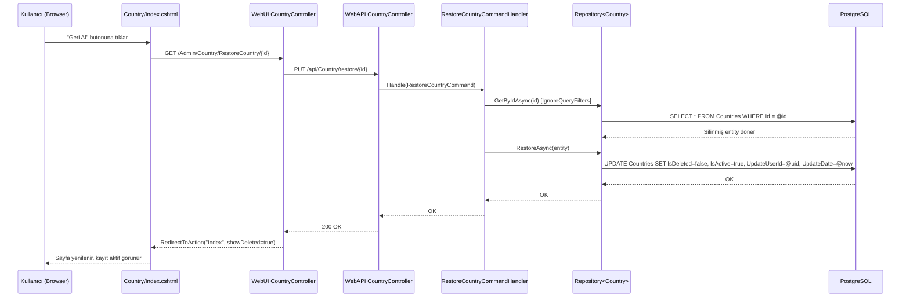

# Geri Alma (Recovery/Restore) Prosedürü - Hayat Döngüsü

## 📋 Genel Bakış

Bu dokümanda, **Country (Ülke)** modülü için silinen kayıtların geri alınması (Restore/Recovery) işleminin tüm katmanlarda nasıl implemente edildiği adım adım açıklanmaktadır.

---

## 🔄 İşlem Akışı (Hayat Döngüsü)

Bir silinmiş kaydın geri alınma süreci aşağıdaki sırayla gerçekleşir:

```
[Kullanıcı Tıklama] → [WebUI View] → [WebUI Controller] → [HTTP PUT API] → [WebAPI Controller] → [CQRS Handler] → [Repository] → [PostgreSQL DB]
```



---

## 📂 Değiştirilen / Oluşturulan Dosyalar

### Katman 1: Domain / Interface Katmanı

#### ✏️ [MODIFY] IRepository.cs
**Dosya:** `Services/Location/Core/Store.Location.Application/Interfaces/IRepository.cs`

**Yapılan:** `RestoreAsync(T entity)` metod imzası interface'e eklendi.

```diff
  Task SoftDeleteAsync(T entity);
+ Task RestoreAsync(T entity);
  Task<T> GetByFilterAsync(Expression<Func<T, bool>> filter);
```

**Neden:** Tüm entity'ler için generic bir restore (geri alma) kontratı tanımlamak. Bu sayede ileride diğer entity'ler (District, City, vb.) için de aynı altyapı kullanılabilir.

---

### Katman 2: Infrastructure / Repository Katmanı

#### ✏️ [MODIFY] Repository.cs
**Dosya:** `Services/Location/Infrastructure/Store.Location.Persistence/Repositories/Repository.cs`

**Yapılan:** `RestoreAsync` metod implementasyonu eklendi.

```csharp
public async Task RestoreAsync(T entity)
{
    if (entity is BaseEntity baseEntity)
    {
        baseEntity.IsDeleted = false;
        baseEntity.IsActive = true;
        baseEntity.UpdateUserId = _userContext.GetClientId();
        baseEntity.UpdateDate = BaseEntity.GetLocalTime();
        // DeleteDate ve DeleteUserId'ye dokunulmaz, tarihsel kayıt korunur.
        _context.Set<T>().Update(entity);
        await _context.SaveChangesAsync();
    }
    else
    {
        throw new NotSupportedException($"'{typeof(T).Name}' tipi restore işlemini desteklemiyor.");
    }
}
```

**Önemli Tasarım Kararları:**
| Alan | Değişiklik | Açıklama |
|------|-----------|----------|
| `IsDeleted` | `false` yapılır | Kayıt artık silinmiş değildir |
| `IsActive` | `true` yapılır | Kayıt tekrar aktif hale gelir |
| `UpdateUserId` | Güncellenir | Geri alma işlemini yapan kullanıcı kaydedilir |
| `UpdateDate` | Güncellenir | Geri alma tarih/saati kaydedilir |
| `DeleteUserId` | **DOKUNULMAZ** | Kim silmiş, tarihsel kayıt olarak korunur |
| `DeleteDate` | **DOKUNULMAZ** | Ne zaman silinmiş, tarihsel kayıt olarak korunur |

---

### Katman 3: Application / CQRS Katmanı

#### 🆕 [NEW] RestoreCountryCommand.cs
**Dosya:** `Services/Location/Core/Store.Location.Application/Features/CQRS/Commands/CountryCommands/RestoreCountryCommand.cs`

**Yapılan:** Geri alma işlemi için CQRS Command sınıfı oluşturuldu. Sadece `Guid Id` taşır.

---

#### 🆕 [NEW] RestoreCountryCommandHandler.cs
**Dosya:** `Services/Location/Core/Store.Location.Application/Features/CQRS/Handlers/sCountryHandlers/RestoreCountryCommandHandler.cs`

**Yapılan:** Command'ı işleyen Handler sınıfı oluşturuldu.

```csharp
public async Task Handle(RestoreCountryCommand command)
{
    var country = await _repository.GetByIdAsync(command.Id);
    if (country == null) return;
    await _repository.RestoreAsync(country);
}
```

**Not:** `GetByIdAsync` metodu `IgnoreQueryFilters()` kullandığı için silinmiş (IsDeleted=true) kayıtları da bulabilir.

---

### Katman 4: WebAPI (Presentation) Katmanı

#### ✏️ [MODIFY] CountriesController.cs
**Dosya:** `Services/Location/Presentation/Store.Location.WebApi/Controllers/CountriesController.cs`

**Yapılan:**
1. Constructor'a `RestoreCountryCommandHandler` inject edildi
2. `PUT /api/Country/restore/{id}` endpoint'i eklendi

```csharp
[HttpPut("restore/{id}")]
public async Task<IActionResult> RestoreCountry(Guid id)
{
    await _restoreCountryCommandHandler.Handle(new RestoreCountryCommand(id));
    return Ok("Country bilgisi başarılı bir şekilde geri alındı (Restore).");
}
```

---

#### ✏️ [MODIFY] Program.cs
**Dosya:** `Services/Location/Presentation/Store.Location.WebApi/Program.cs`

**Yapılan:** `RestoreCountryCommandHandler` DI container'a kaydedildi.

```diff
  builder.Services.AddScoped<SoftDeleteCountryCommandHandler>();
+ builder.Services.AddScoped<RestoreCountryCommandHandler>();
  builder.Services.AddScoped<UpdateCountryCommandHandler>();
```

---

### Katman 5: WebUI (Frontend) Katmanı

#### ✏️ [MODIFY] CountryController.cs (WebUI)
**Dosya:** `FrontEnds/Store.WebUI/Areas/Admin/Controllers/CountryController.cs`

**Yapılan:** `RestoreCountry(Guid id)` action metodu eklendi.

```csharp
public async Task<IActionResult> RestoreCountry(Guid id)
{
    var client = _httpClientFactory.CreateClient();
    var responseMessage = await client.PutAsync($"https://localhost:7303/api/Country/restore/{id}", null);
    if (responseMessage.IsSuccessStatusCode)
    {
        return RedirectToAction("Index", "Country", new { area = "Admin", showDeleted = true });
    }
    TempData["ErrorMessage"] = "Geri alma işlemi sırasında bir hata oluştu.";
    return RedirectToAction("Index", "Country", new { area = "Admin", showDeleted = true });
}
```

**Not:** Başarılı geri alma sonrası `showDeleted=true` ile yönlendirir, böylece kullanıcı kaydın durumunu hemen görebilir.

---

#### ✏️ [MODIFY] Country/Index.cshtml
**Dosya:** `FrontEnds/Store.WebUI/Areas/Admin/Views/Country/Index.cshtml`

**Yapılan:** İşlemler sütunundaki butonlar koşullu hale getirildi:

- **Aktif/Pasif kayıtlar:** 3 buton gösterilir → Detay + Güncelle + Sil
- **Silinmiş kayıtlar:** 2 buton gösterilir → Detay + Geri Al (Recovery)

```html
@if (item.IsDeleted)
{
    <!-- Recovery Butonu - 2 buton genişliğinde -->
    <a href="/Admin/Country/RestoreCountry/@item.Id" 
       class="btn btn-grd-warning waves-effect waves-light"
       style="float: none; margin: 5px; min-width: 70px; padding: 6px 16px;"
       onclick="return confirm('Bu kaydı geri almak istediğinize emin misiniz?')">
        <i class="feather icon-rotate-ccw"></i> Geri Al
    </a>
}
else
{
    <!-- Normal Güncelle + Sil butonları -->
}
```

**Buton Özellikleri:**
- 🟡 Sarı/warning renk teması (geri alma işlemini temsil eder)
- 🔄 `icon-rotate-ccw` ikonu (geri alma simgesi)
- ⚠️ Onay dialogu ile kullanıcıdan teyit alınır
- 📐 `min-width: 70px` ile 2 buton genişliğinde boyutlandırılmıştır

---

## 🧪 Derleme Sonucu

```
Derleme Başarılı
    168 Uyarı (önceden mevcut, bu değişiklikle ilgisiz)
    0 Hata
```

---

## 🔮 İleride Diğer Entity'lere Uygulamak İçin

Bu yapı generic olarak tasarlandığından, aynı Recovery işlemini diğer entity'lere (District, City, Neighborhood, vb.) eklemek için şu adımlar izlenmelidir:

1. **CQRS Command** oluştur → `Restore{Entity}Command.cs`
2. **CQRS Handler** oluştur → `Restore{Entity}CommandHandler.cs`
3. **WebAPI Controller**'a endpoint ekle → `PUT /api/{Entity}/restore/{id}`
4. **Program.cs**'ye handler'ı kaydet
5. **WebUI Controller**'a action ekle → `Restore{Entity}(Guid id)`
6. **Index.cshtml**'de silinmiş kayıtlar için Recovery butonu ekle

`IRepository.RestoreAsync()` ve `Repository.RestoreAsync()` zaten tüm entity'ler için hazırdır, tekrar eklemeye gerek yoktur.
