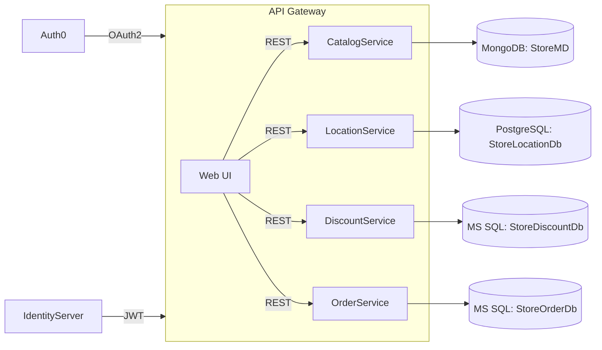
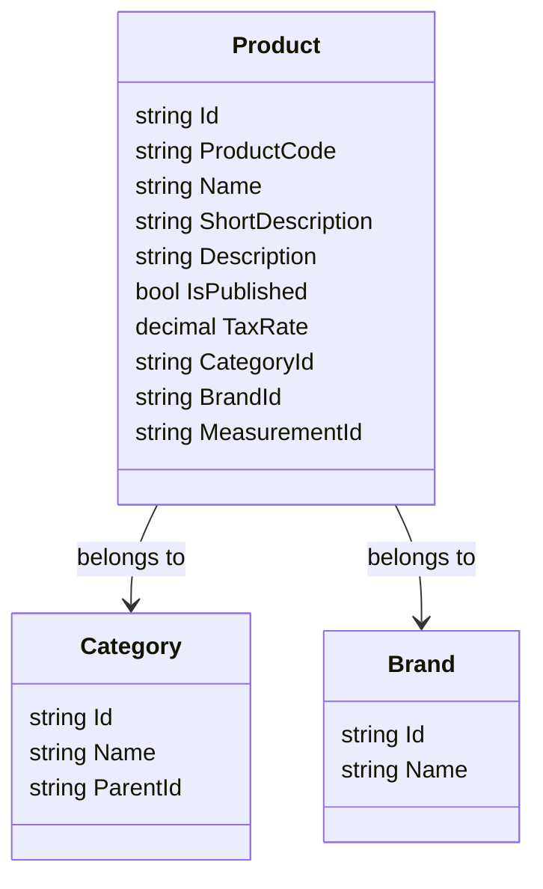

# Project Context Documentation (English)

## 1. Project Overview & Business Logic
The **Store** solution is a B2B e‑commerce platform supporting two distinct purchasing models:
- **Sale (Purchase) Model** – Customers buy products outright. The order flow creates an `Order` entity and persists payment details.
- **Rent (Rental) Model** – Customers rent products for a defined period. The system creates a `RentalContract` that tracks start/end dates, usage fees and automatic renewal logic.

Both models share a **Cart** subsystem that aggregates selected items, calculates taxes, discounts and shipping before finalizing either a purchase or a rental.

## 2. Architecture & Technology Stack
- **Platform:** .NET 6 (ASP.NET Core MVC) with a **Micro‑service** architecture.
- **Layering:** Onion Architecture (Core → Application → Infrastructure → Presentation).
- **Authentication & Authorization:** Auth0 integrated via OpenID Connect; additional internal IdentityServer for API token issuance.
- **Security:** JWT access tokens, role‑based policies, HTTPS‑only endpoints, CSP headers.
- **API Gateway:** (if present) – reverse proxy routing to micro‑services.
- **Messaging:** (future) RabbitMQ / Azure Service Bus for async events.
- **Logging & Monitoring:** Serilog with Seq, health checks, OpenTelemetry.
- **CI/CD:** GitHub Actions, Docker containers.

### 2.1 Core Layers
| Layer | Purpose |
| ----- | ------- |
| **Domain** (Core) | Entities, value objects, domain events, interfaces. |
| **Application** | Use‑case services, DTOs, validation. |
| **Infrastructure** | Repository implementations (EF Core, Dapper, MongoDB drivers), external service clients. |
| **Presentation** | ASP.NET MVC Controllers, Razor Views, API Controllers. |

### 2.2 Additional Modules
- **IdentityServer** – token service for internal APIs.
- **Store.DtoLayer** – shared Data Transfer Objects across services.
- **Store.Services** – cross‑cutting services (email, caching, notifications).

## 3. Database Infrastructure
| Microservice | DBMS | Database Name | Primary Collections / Tables |
| ------------ | ---- | ------------- | --------------------------- |
| **Catalog** | MongoDB | `StoreMD` | `Brands`, `Categories`, `Products`, `ProductDetails`, `ProductImages`, `ProductPrices`, `Measurements`, `Currencies` |
| **Location** | PostgreSQL | `StoreLocationDb` | `Countries`, `Cities`, `Districts`, `Neighborhoods`, `Companies`, `Branches`, `BranchAddresses`, `UserAddresses`, `Warehouses`, `ContactInfos` |
| **Discount** | MS SQL Server | `StoreDiscountDb` | `Coupons` |
| **Order** | MS SQL Server | `StoreOrderDb` | `Orders`, `OrderDetails`, `Addresses` |

### 3.1 Mermaid Diagram – High‑Level Architecture

### 3.2 Mermaid Diagram – Sample MongoDB Schema (Products)

## 4. Current Microservices & Communication
- **Catalog Service** – Provides product catalog, brand, category, measurement data. Exposes REST endpoints and gRPC for internal calls.
- **Location Service** – Manages geographic entities (countries, cities, addresses, warehouses). Uses PostgreSQL.
- **Discount Service** – Handles coupon creation, validation, and discount rules.
- **Order Service** – Processes orders, rentals, payment settlement, and order history.
- **Auth Service (Auth0 & IdentityServer)** – Central authentication, SSO, and API token generation.

Communication is primarily **HTTP/HTTPS** REST; future plans include **event‑driven** architecture via a message broker.

## 5. Current Status (Completed Work)
- UI migration from inline `onclick="return confirm"` to global SweetAlert2 handlers.
- Basic CRUD for **Products**, **Categories**, **Brands** in Catalog Service.
- Entity base classes (`BaseEntity`, `AddressBase`) implemented across services.
- Database scripts for initial schema creation (MongoDB collections, PostgreSQL tables, MSSQL tables).
- Middleware for global exception handling and logging.
- CI pipeline set up for Docker image builds.

## 6. Pending Work & Future Goals
- **Mobile App Integration** – expose clean REST APIs, add OpenAPI spec, generate SDKs.
- **Event‑Driven Architecture** – implement RabbitMQ topics for order events, inventory updates.
- **Advanced Search** – integrate Elasticsearch for product catalog.
- **Multi‑Tenant Support** – isolate tenant data per schema/database.
- **Performance Optimizations** – caching layer (Redis) for product lookups.
- **Documentation** – finalize `project_context.md` (this file) and generate PDF/HTML outputs.
- **Testing** – increase unit‑test coverage, add integration tests for cross‑service flows.

---
*Generated automatically for reference. Update as the project evolves.*
